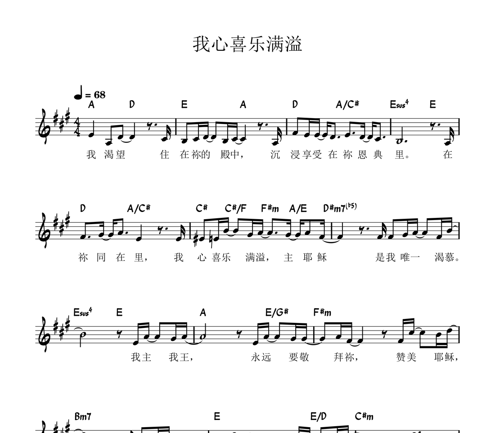

# music-preprocessor

**English** · [简体中文](README.zh-CN.md)

Turn a plain-text jianpu (numbered notation) DSL into a **MuseScore 4** lead sheet —
`.mscz`, `.pdf` or `.png` — through standard MusicXML.



Write music as text, get an editable, printable score. No Finale / Sibelius / LilyPond
installation needed: MuseScore 4 does the engraving, and the `.dsl` source stays small
enough to live in git.

## How it works

```
song.dsl ─► lexer ─► parser ─► IR ─┬─► MusicXML ─► MuseScore 4 ─► .mscz / .pdf / .png
                                   └─► LilyPond  ─► .ly            (legacy, unmaintained)
```

## Requirements

| Requirement | Notes |
|---|---|
| Python 3.9+ | required |
| MuseScore 4 | needed for the default `.mscz` output and for `.pdf` / `.png`; auto-detected in the usual install locations, or pass `--musescore PATH` / set `MPP_MUSESCORE` |

Without MuseScore you can still emit `.musicxml` (open it in MuseScore by hand) or `.ly`.

## Quick start

```bash
python mpp.py song.dsl                  # → song.mscz  (default)
python mpp.py song.dsl -f pdf           # → song.pdf
python mpp.py song.dsl -f mscz,pdf      # both
python mpp.py song.dsl -f musicxml -o song.musicxml
python mpp.py song.dsl -f ly            # legacy: LilyPond source on stdout
```

On Windows you can use `mpp.cmd` instead of `python mpp.py`.

### Options

| Option | Description |
|---|---|
| `-f, --format` | `mscz` (default) \| `pdf` \| `png` \| `musicxml` \| `ly` (legacy); comma-separate for several |
| `-o, --output` | output path (single format only) |
| `--musescore` | path to `MuseScore4.exe` |
| `--style` | MuseScore style file, defaults to `assets/jazz-lead-sheet.mss` |
| `--no-style` | don't apply the lead-sheet style |
| `--keep-xml` | keep the intermediate `.musicxml` |
| `-q, --quiet` | suppress warnings |

## The DSL in 20 seconds

```text
Title:小星星
Subtitle:带和弦的 Lead Sheet
Composer:曲：传统
Key:C Time:4/4          % pickup: Time:3/4,4
Tempo:4=100

H: 一闪一闪亮晶晶        % one hanzi per note; H1:/H2: for verses
[C] 1 1 [G7] 5 5 | [Am] 6 6 [D7] 5 - |
1' ^"Chorus" \break 7 6 5 |
```

| Token | Meaning |
|---|---|
| `1` … `7` | scale degrees of the key |
| `0` / `x` | rest |
| `'` / `,` | octave up / down (`1'`, `1,`) |
| `#` / `b` | sharp / flat (`#4`, `b7`) |
| `.` | dotted note (`1.`) |
| `-` | extend the previous note by one beat |
| `~` | tie to the next note |
| `(` `)` | slur start / end |
| `[C]` | chord symbol for the next note |
| `\|` | barline (`\|\|` double bar) |
| `q` `s` `d` `c` `h` | eighth / 16th / 32nd / quarter / 64th |
| `\break` | system break |
| `^"text"` / `_"text"` | text above / below the staff |
| `%` | comment |

A line of music in the source becomes a system on the page, so you control the layout
with plain line breaks.

Full reference (Chinese): **[docs/DSL.md](docs/DSL.md)** — cheat sheet, every token,
lyrics/verse rules, error messages and runnable examples in [`examples/`](examples/).

## Typography

The look comes from `assets/jazz-lead-sheet.mss` (based on MuseScore's *Jazz Lead Sheet*
template). Frequently tweaked values:

| Style key | Value | Effect |
|---|---|---|
| `chordSymbolAFontSize` / `BFontSize` | 12 / 10 | chord symbol size |
| `chordSymbolAFontStyle` / `BFontStyle` | 0 / 0 | 0 = not bold |
| `lyricsOddFontSize` / `EvenFontSize` | 12 | lyric size |
| `chordSymbolPosAbove` | y = -2.5 | distance above the staff |

## Notes & limitations

| Item | Behaviour |
|---|---|
| `LP: … :LP` raw LilyPond | only affects `.ly`; ignored (with a warning) for MusicXML |
| `\command` / `^"text"` | MusicXML maps `\break`, `\bar "…"`, `^"…"` / `_"…"`; anything else warns. `.ly` passes them through |
| Chord symbols | handed to MuseScore's parser: `C6/9` survives, `G7sus4` is normalised to `G7sus⁴` |
| Repeats `R{}` / `A{}` | not supported yet (raises an error) |
| Lyrics placement | a lyric line starts at the first note of the music line above it; parallel verses share the same position |
| LilyPond backend | **legacy**, unmaintained — kept for `-f ly` only |

## Project layout

```
music-preprocessor-py/
├── mpp.py                 # CLI entry point
├── mpp/
│   ├── lexer.py           # tokenizer
│   ├── parser.py          # parser → IR
│   ├── ir.py              # Score / Measure / Note
│   ├── lyrics.py          # lyric splitting, verse placement
│   ├── musicxml.py        # MusicXML backend (lead sheet)
│   ├── musescore.py       # MuseScore CLI wrapper
│   ├── lilypond.py        # LilyPond backend (legacy)
│   └── cli.py             # command line
├── assets/jazz-lead-sheet.mss   # page style
├── docs/DSL.md            # DSL reference (Chinese)
├── examples/              # runnable sample scores
└── tests/                 # 29 tests + 19 demo scores as fixtures
```

## Tests

```bash
python -m unittest discover -s tests
```

Covers all 19 demo scores end to end, pitch/key/chord/lyric/pickup/tie handling,
error input and CLI behaviour.
