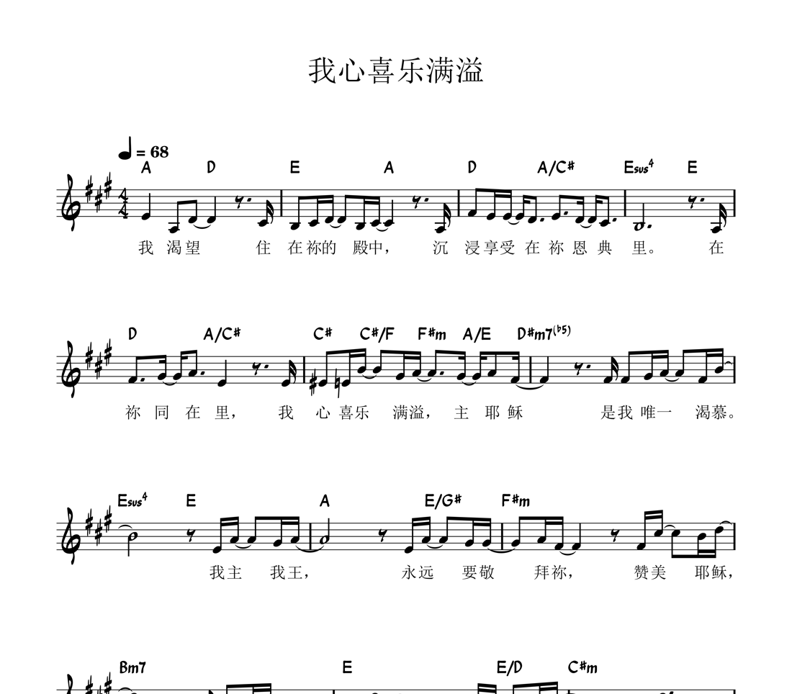

# music-preprocessor

[English](README.md) · **简体中文**

把纯文本的简谱 DSL 转成 **MuseScore 4** 的 lead sheet —— `.mscz`、`.pdf` 或 `.png`，
中间走标准的 MusicXML。



用文本写歌，得到可编辑、可打印的谱子。不需要装 Finale / Sibelius / LilyPond，
排版交给 MuseScore 4；`.dsl` 源文件很小，适合放进 git。

## 工作方式

```
song.dsl ─► 词法 ─► 语法 ─► IR ─┬─► MusicXML ─► MuseScore 4 ─► .mscz / .pdf / .png
                                └─► LilyPond  ─► .ly            （legacy，不再维护）
```

## 依赖

| 依赖 | 说明 |
|---|---|
| Python 3.9+ | 必填 |
| MuseScore 4 | 默认输出 `.mscz` 以及 `.pdf` / `.png` 需要；会自动在常见安装位置查找，也可以 `--musescore PATH` 或设 `MPP_MUSESCORE` |

没装 MuseScore 也能用 `-f musicxml` 出中间文件（手工用 MuseScore 打开），或者 `-f ly`。

## 快速开始

```bash
python mpp.py song.dsl                  # → song.mscz（默认）
python mpp.py song.dsl -f pdf           # → song.pdf
python mpp.py song.dsl -f mscz,pdf      # 两个都要
python mpp.py song.dsl -f musicxml -o song.musicxml
python mpp.py song.dsl -f ly            # legacy：LilyPond 源码打到 stdout
```

Windows 上可以用 `mpp.cmd` 代替 `python mpp.py`。

### 参数

| 参数 | 说明 |
|---|---|
| `-f, --format` | `mscz`（默认）\| `pdf` \| `png` \| `musicxml` \| `ly`（legacy），可逗号组合 |
| `-o, --output` | 输出路径（只能配合单格式） |
| `--musescore` | 指定 `MuseScore4.exe` |
| `--style` | MuseScore 样式文件，默认 `assets/jazz-lead-sheet.mss` |
| `--no-style` | 不套 lead sheet 样式 |
| `--keep-xml` | 保留中间 `.musicxml` |
| `-q, --quiet` | 不打印 warning |

## 20 秒看懂 DSL

```text
Title:小星星
Subtitle:带和弦的 Lead Sheet
Composer:曲：传统
Key:C Time:4/4          % 弱起写 Time:3/4,4
Tempo:4=100

H: 一闪一闪亮晶晶        % 汉字一字一音；H1:/H2: 分段
[C] 1 1 [G7] 5 5 | [Am] 6 6 [D7] 5 - |
1' ^"Chorus" \break 7 6 5 |
```

| 记号 | 含义 |
|---|---|
| `1` … `7` | 本调音级 |
| `0` / `x` | 休止 |
| `'` / `,` | 升 / 降八度（`1'`、`1,`） |
| `#` / `b` | 升 / 降半音（`#4`、`b7`） |
| `.` | 附点（`1.`） |
| `-` | 前一个音延长一拍 |
| `~` | 连音线（到下一个音） |
| `(` `)` | 圆滑线起 / 止 |
| `[C]` | 和弦标记，作用于下一个音 |
| `\|` | 小节线（`\|\|` 双小节线） |
| `q` `s` `d` `c` `h` | 八分 / 十六分 / 三十二分 / 四分 / 六十四分 |
| `\break` | 换行（谱面换系统） |
| `^"文字"` / `_"文字"` | 谱上 / 谱下文字 |
| `%` | 注释 |

源文件里怎么换行，谱面上就怎么换行 —— 排版直接用换行控制。

完整参考：**[docs/DSL.md](docs/DSL.md)**（中文）· **[docs/DSL.en.md](docs/DSL.en.md)**（English）——
速查卡、每个记号、歌词/分段规则、报错说明，以及 [`examples/`](examples/) 里可直接运行的例子。

## 版式

样式在 `assets/jazz-lead-sheet.mss`（基于 MuseScore 的 *Jazz Lead Sheet* 模板），常用项：

| 样式项 | 当前值 | 作用 |
|---|---|---|
| `chordSymbolAFontSize` / `BFontSize` | 12 / 10 | 和弦符号字号 |
| `chordSymbolAFontStyle` / `BFontStyle` | 0 / 0 | 0 = 不加粗 |
| `lyricsOddFontSize` / `EvenFontSize` | 12 | 歌词字号 |
| `chordSymbolPosAbove` | y = -2.5 | 和弦离五线谱的高度 |

## 说明与限制

| 项 | 行为 |
|---|---|
| `LP: … :LP` 原样 LilyPond | 只对 `.ly` 生效；转 MusicXML 时忽略并 warning |
| `\命令` / `^"文字"` | MusicXML 映射 `\break`、`\bar "…"`、`^"…"` / `_"…"`，其余 warning；`.ly` 原样输出 |
| 和弦写法 | 交给 MuseScore 解析：`C6/9` 保留，`G7sus4` 会被规范成 `G7sus⁴` |
| 反复 `R{}` / `A{}` | 暂不支持，会报错 |
| 歌词位置 | 写在某行音乐下面 → 从那一行第一个音开始；平行段落对齐同一位置 |
| LilyPond 后端 | **legacy**，不再维护，只保留 `-f ly` |

## 目录结构

```
music-preprocessor-py/
├── mpp.py                 # 命令行入口
├── mpp/
│   ├── lexer.py           # 词法
│   ├── parser.py          # 语法 → IR
│   ├── ir.py              # Score / Measure / Note
│   ├── lyrics.py          # 歌词分行、分句、对齐
│   ├── musicxml.py        # MusicXML 后端（lead sheet）
│   ├── musescore.py       # MuseScore CLI 调用
│   ├── lilypond.py        # LilyPond 后端（legacy）
│   └── cli.py             # 命令行
├── assets/jazz-lead-sheet.mss   # 谱面样式
├── docs/DSL.md            # DSL 语法文档
├── examples/              # 示例谱
└── tests/                 # 29 个测试 + 19 个 demo 谱作为 fixtures
```

## 测试

```bash
python -m unittest discover -s tests
```

覆盖：19 个 demo 全部转换、音高/调号/和弦/歌词/弱起/连音线、错误输入、CLI 行为。

## 许可证

MIT，见 [LICENSE](LICENSE)。
